  

###

 

<h1 data-importer="text" align="center">Amanda Cardoso</h1>

###

  

###

  

###

<h3 data-importer="text" align="center">Sou estudante de Ciência da Computação na Universidade Estadual de Santa Cruz (UESC) e técnica em Desenvolvimento de Sistemas pelo SENAI. Gosto de aprender construindo: de aplicativos com IA e soluções de backend a projetos com Arduino.  Minha trajetória inclui hackathons, iniciação científica, extensão universitária e participação no EmbarcaTech. Atualmente, aprofundo meus estudos em Inteligência Artificial e LLMs.</h3>

###

  

###

  
  
  
  
  
  
  
  
  
  
  
  
  

###

  

###

